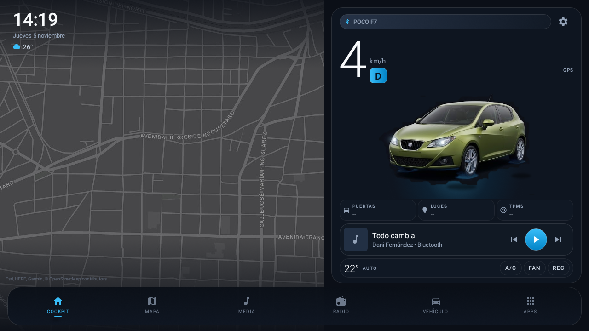

# IbizaDash

Launcher/dashboard estilo Tesla para el **SEAT Ibiza 6J 2010, 2.0 Style 4 puertas**
(motor **CEKA** 2.0 MPI 8V, 115 hp, mercado México) con la head unit **SPRD sp7731e**
(Android 8.1, 1280×720, 2 GB RAM).



- **APK publicados:** [Releases de GitHub](https://github.com/ChronosBVRX/IbizaDash/releases/latest)
  (`IbizaDash.apk` para el estéreo, `IbizaCompanion.apk` para el teléfono).
- **Paquete del estéreo:** `com.chronosbvrx.ibizadash`
- **Paquete del teléfono:** `com.chronosbvrx.ibizacompanion`
- **Versiones actuales:** IbizaDash **1.4.1** (versionCode 18) · IbizaCompanion **1.4.1** (versionCode 13)
- **minSdk 23 / targetSdk 33 / compileSdk 36** (estéreo)
- Hecho con **Views** (sin Compose) en el estéreo para que sea liviano en el Cortex-A7.

---

## Arquitectura: el teléfono es la única fuente de Internet

```
┌──────────────────────────────┐        Wi-Fi Direct / TCP        ┌────────────────────────────┐
│  IbizaCompanion (teléfono)   │ ───────────────────────────────► │  IbizaDash (estéreo)       │
│  GPS · rutas · mapas · clima │   JSON por línea · puerto 47800  │  dashboard · media · OTA   │
│  portadas · OTA (GitHub)     │ ◄─────────────────────────────── │  solo pinta y reproduce    │
└──────────────────────────────┘                                  └────────────────────────────┘
```

- **Wi-Fi Direct es el único canal de datos.** No hay puente Bluetooth de datos ni respaldo RFCOMM.
- **Bluetooth** se conserva solo para lo que no puede ir por Wi-Fi: audio **A2DP/AVRCP**,
  llamadas **HFP** y adaptadores **ELM327/OBD**.
- **El estéreo no consulta Internet**: no descarga clima, carátulas ni mapas. Recibe todo del
  teléfono o usa su caché local de teselas.
- **El clima** lo calcula IbizaCompanion con Open-Meteo y lo envía como mensaje `WEATHER`.
- **La OTA** la descarga el teléfono del último release de GitHub y la envía por Wi-Fi Direct.
  El estéreo verifica tamaño, SHA-256, paquete y firma antes de abrir el instalador del sistema.

---

## Qué incluye

| Función | Estado |
|---|---|
| Launcher HOME landscape | ✅ |
| Mapa oscuro con GPS (Esri Dark Gray Canvas) y caché offline | ✅ |
| Render SEAT Ibiza 2010 verde (3/4 frontal) | ✅ |
| Velocidad **OBD > CAN > GPS** (OBD expira a los 4 s) | ✅ |
| Unidades km/h / mph | ✅ |
| Reloj, fecha y clima (clima enviado por el teléfono) | ✅ |
| Reversa automática (AIDL de `com.tw.service.xt`) | ✅ |
| Lanzar app de cámara `com.tw.reverse` | ✅ |
| Controles de media (play/pausa, anterior, siguiente) | ✅ |
| Media Bluetooth: título, artista, carátula (catálogo offline) | ✅ |
| Estado Bluetooth: nombre, A2DP/HFP, batería, llamada | ✅ |
| Navegación turn-by-turn en el estéreo (banner, calle, ETA) | ✅ |
| Navegación y mapa calculados en el teléfono | ✅ |
| Wi-Fi Direct para rutas, mapas, portadas, clima y OTA | ✅ |
| Dock: Mapa, Media, Radio, Teléfono, Cámara, Apps | ✅ |
| Cajón de aplicaciones | ✅ |
| Ajustes rápidos desplazables (incluye fila OTA) | ✅ |
| Radio FM/AM integrada (MCU) | ✅ |
| RPM, puertas, luces, TPMS por CAN | ⏳ pendiente |
| Mapas offline (Esri Dark z11–z15, Michoacán + vecinos) | ✅ |

---

## Estructura

```
IbizaDash/
├─ app/src/main/java/com/chronosbvrx/ibizadash/
│  ├─ MainActivity.kt          # dashboard principal
│  ├─ MapActivity.kt           # mapa a pantalla completa
│  ├─ AppsActivity.kt          # cajón de apps
│  ├─ SettingsActivity.kt      # ajustes
│  ├─ App.kt                   # configuración de osmdroid
│  ├─ car/                     # CAN, AIDL del MCU, reversa, llamadas
│  ├─ map/MapHelper.kt         # Esri Dark Gray + caché
│  ├─ media/                   # media A2DP/AVRCP y catálogo offline
│  ├─ nav/                     # puente Wi-Fi, rutas, navegación
│  ├─ ota/                     # recepción y instalación de APK
│  ├─ weather/                 # clima recibido del teléfono
│  ├─ obd/                     # ELM327 (Bluetooth SPP/BLE)
│  └─ ui/CarSilhouetteView.kt  # coche dibujado con Canvas
├─ companion-app/              # proyecto Gradle independiente del teléfono
├─ docs/                       # especificaciones y traspasos
├─ scripts/                    # utilidades de mapas offline
└─ screenshots/
```

---

## Compilar

```powershell
$env:JAVA_HOME="C:\Program Files\Android\Android Studio\jbr"
cd C:\Users\Axel Rosete\Desktop\Proyectos\General\IbizaDash
.\gradlew.bat :app:assembleRelease
```

Salida: `app/build/outputs/apk/release/app-release.apk`.

### Compilar la app compañera (teléfono)

El proyecto de la compañera es un Gradle independiente dentro de `companion-app/`.
Se compila con el wrapper de la raíz:

```powershell
$env:JAVA_HOME="C:\Program Files\Android\Android Studio\jbr"
cd C:\Users\Axel Rosete\Desktop\Proyectos\General\IbizaDash
.\gradlew.bat -p companion-app :app:assembleRelease
```

Salida: `companion-app/app/build/outputs/apk/release/app-release.apk`.

Requisitos:

- JDK 17 y Android SDK 34.
- El AAR de Spotify está en `companion-app/app/libs/` (13 MB); no se descarga de Maven.
- La búsqueda exacta de YouTube usa una API key **opcional** en
  `companion-app/local.properties` (`YOUTUBE_API_KEY=...`). No subas esa key al repositorio.

---

## Firma

Las dos apps usan una **keystore fija** para que las actualizaciones entren sin desinstalar:

- Ruta local en esta PC: `%USERPROFILE%\.android\ibizadash-release.jks`
- Respaldo: `%USERPROFILE%\Documents\IbizaDash-keys\ibizadash-release.jks`
- Certificado SHA-256: `95:93:CB:0D:2B:44:B8:C5:A4:7C:15:7C:13:34:2C:3D:4A:55:62:98:43:D5:62:D2:C0:49:33:1E:C7:74:73:F3`

La ruta, el alias y las contraseñas se leen de `local.properties` (ignorado por Git), nunca
del repo. Si cambias de PC, copia la keystore y crea el mismo `local.properties`.

---

## Instalar la primera vez (solo esta vez)

El estéreo necesita una instalación inicial por ADB; después las actualizaciones ya no usan ADB.

```powershell
adb connect <IP_DEL_ESTEREO>:5555
adb install -r IbizaDash.apk
adb shell pm grant com.chronosbvrx.ibizadash android.permission.ACCESS_FINE_LOCATION
adb shell cmd package set-home-activity com.chronosbvrx.ibizadash/.MainActivity
```

En el teléfono:

```powershell
adb install -r IbizaCompanion.apk
adb shell pm grant com.chronosbvrx.ibizacompanion android.permission.ACCESS_FINE_LOCATION
adb shell pm grant com.chronosbvrx.ibizacompanion android.permission.ACCESS_COARSE_LOCATION
adb shell pm grant com.chronosbvrx.ibizacompanion android.permission.POST_NOTIFICATIONS
```

La primera vez hay que aceptar el diálogo de ubicación en pantalla (o usar `pm grant`).
Después de reiniciar el estéreo, la autorización ADB se pierde en esta ROM; hay que
volver a aceptar el diálogo RSA al arrancar.

### Actualizar sin ADB (OTA)

1. Abre **IbizaCompanion → Conexión** y espera a que diga **Wi-Fi Direct conectado**.
2. La app consulta GitHub y muestra "Estéreo X · disponible Y".
3. Toca **Actualizar estéreo**. El APK viaja por Wi-Fi Direct.
4. En el estéreo abre **Ajustes rápidos → Actualización del sistema → toca para instalar**.
5. Confirma **Instalar** en el diálogo del sistema.

El estéreo verifica que el APK sea `com.chronosbvrx.ibizadash`, que la versión coincida,
que el SHA-256 sea correcto y que esté firmado con la misma keystore. Si algo falla, rechaza
la actualización y conserva la versión instalada.

### Actualizar la propia app del teléfono (automático)

IbizaCompanion también se actualiza desde el mismo release de GitHub:

1. El servicio en primer plano consulta `releases/latest/download/IbizaCompanion.apk` al
   arrancar y cada 6 horas.
2. Si hay una versión más nueva, la descarga y verifica (paquete y SHA-256).
3. Aparece un aviso en Inicio, en Ajustes y en la notificación del puente.
4. Un toque abre el instalador del sistema; Android pide confirmar (no se puede instalar
   en silencio sin ser app de sistema).

La primera vez hay que permitir **Instalar apps desconocidas** para IbizaCompanion; si falta,
la app abre directamente ese ajuste.

### Voz de navegación (sin Internet en el coche)

El estéreo no tiene motor de voz ni conexión. El teléfono sintetiza cada frase con el TTS
del sistema y la envía por Wi-Fi Direct como un WAV corto:

1. Al fijar una ruta, el estéreo pide al teléfono solo las frases que le faltan
   (`VOICE_REQ`): maniobras de esa ruta y distancias fijas (800/400/200/100/50 m).
2. El teléfono las sintetiza en español de México, las cachea y las envía (`VOICE_CLIP`).
3. El estéreo las guarda en `files/voice/` y las reproduce cuando toca, bajando la música
   (audio focus con *ducking*).

Se activa o desactiva en **Ajustes rápidos → Navegación → Voz de navegación**, donde también
se ve el peso de la caché y se puede liberar. Las frases se piden una sola vez.

### Tráfico en tiempo real (TomTom)

La ruta se calcula con **tráfico real**: ETA, tramos lentos coloreados y aviso de retraso.

La clave se pega **una vez en el teléfono**: `Ajustes → TRÁFICO EN TIEMPO REAL → Añadir clave`.
Se guarda en las preferencias del teléfono y **no viaja dentro del APK**, porque el release es
público en GitHub. Si no hay clave, la app calcula la ruta igual (OSRM) sin datos de tráfico.

El estéreo pinta los tramos con retraso en rojo/ámbar sobre la ruta y muestra
`TRÁFICO +X MIN` cuando el retraso supera un minuto. Esa información viaja en `ROUTE_SET`
(`trafficDelayS` y `trafficSections`), así que no necesita Internet en el coche.

Si el proveedor falla o agota la cuota, `RouteBuilder` cae automáticamente a OSRM: nunca se
queda sin ruta.

### Módulos descargables

Contenido extra (teselas offline, voces, datos) que viaja del teléfono al estéreo:

1. El release publica `modules.json` con la lista (id, tipo, versión, tamaño, SHA-256 y URL).
2. **Ajustes → Módulos** muestra lo disponible y lo instala con un toque.
3. El teléfono descarga el ZIP y lo envía por Wi-Fi Direct en bloques.
4. El estéreo verifica **SHA-256**, descomprime evitando rutas maliciosas y registra el
   módulo en `files/modules.json`.

Tipos soportados: `tiles` (PNG en `{z}/{x}/{y}.png` que van a la caché de osmdroid) y
`voice` (WAV por clave de frase). En **Ajustes rápidos → Módulos del estéreo** se ven los
instalados, su tamaño y se puede quitar el registro.

Primer módulo publicado: **`tiles-morelia` v1** — 13,7 MB, 2464 teselas z13–z16 alrededor de
Morelia.

Si el release no incluye `modules.json`, la app simplemente indica que no hay módulos.
Para pruebas locales se puede apuntar el catálogo a un servidor de la PC (solo `10.0.2.2`,
`localhost` y `127.0.0.1` permiten HTTP en claro; el resto exige HTTPS).

#### Publicar un pack de tu ciudad

```powershell
# 1) Descarga las teselas (caja de 24×24 km alrededor del centro, z13–z16)
python scripts\build_city_pack.py --name tiles-morelia --lat 19.7060 --lon -101.1950 --km 12 --zooms 13-16

# 2) Súbelo al release más reciente
gh release upload v1.4.0 dist\city-pack\tiles-morelia.zip dist\city-pack\modules.json --clobber
```

El script genera el ZIP con la estructura `{z}/{x}/{y}.png` y el `modules.json` con tamaño y
SHA-256 ya calculados. En **Ajustes → Módulos** aparece y se instala con un toque.

---

## Mapas offline

- El estéreo usa **solo la caché local** y las teselas que el teléfono envía con `TILE_BATCH`.
- El teléfono puede generar/instalar un pack de teselas con `scripts/build_offline_pack.py`.
- Los `.mbtiles` (~1.2 GB) y los APK **no** se versionan en Git: se regeneran o se descargan
  de **Releases**.

---

## Cortes de música por Wi-Fi + Bluetooth

El estéreo (`sp7731e`, SC7731E) usa un chip combo **solo de 2,4 GHz**: Wi-Fi Direct y el
audio A2DP comparten antena, así que un pico de datos ahoga el Bluetooth. Lo que ya hace
la app para reducirlo:

- **Mapa remoto** (`MAP_FRAME`): WebP q65 en vez de JPEG q80, 1,7–2,5 fps, sin repetir
  frames idénticos (se reenvía uno cada 2 s para que el estéreo no pierda la proyección) y
  *throttle* adaptativo si el TCP empieza a llenarse.
- **Teselas** (`TILE_BATCH`): tope de 8 MB (antes 12 MB) y ritmo máximo ~400 KB/s al
  iniciar una ruta, para no saturar el enlace durante la descarga.
- **Portadas**: 384 px (antes 512 px).
- **Grupo Wi-Fi Direct en 5 GHz**: `WifiP2pConfig.Builder.setGroupOperatingBand` (API 29+),
  con caída automática a 2,4 GHz si el chip no es dual-band. En **Ajustes** aparece como
  *Wi-Fi Direct en 5 GHz*; en el `sp7731e` actual sale deshabilitado porque ni la API ni
  el chip lo permiten.

Si todavía se corta, en el teléfono: **Opciones de desarrollador → códec de audio
Bluetooth → SBC** y desactivar la sincronización de contactos/historial del perfil.
**No** desactives "Audio multimedia": la música viaja del teléfono al estéreo por A2DP,
no por Wi-Fi Direct.

---

## Volver a LiteDash

Si algo sale mal y el estéreo se queda sin launcher utilizable:

```powershell
adb shell cmd package set-home-activity com.irvingguerra.litedash/.MainActivity
```

Mantén siempre un APK de IbizaDash funcional a mano (`dist/IbizaDash.apk` o el release).

---

## Notas de campo

- El estéreo es `sp7731e_1h10_native`, Android 8.1 (API 27), 1280×720.
- La app del estéreo corre en el proceso principal; el OBD y la radio usan el MCU del proveedor.
- El teléfono POCO puede tardar en reconectar Wi-Fi Direct después de apagar la pantalla;
  el watchdog del servicio reintenta cada 15 s.
- Los logs útiles: `adb logcat -s WifiNavBridge WifiBridge OtaSender OtaReceiver MediaBridge WeatherSender`.
